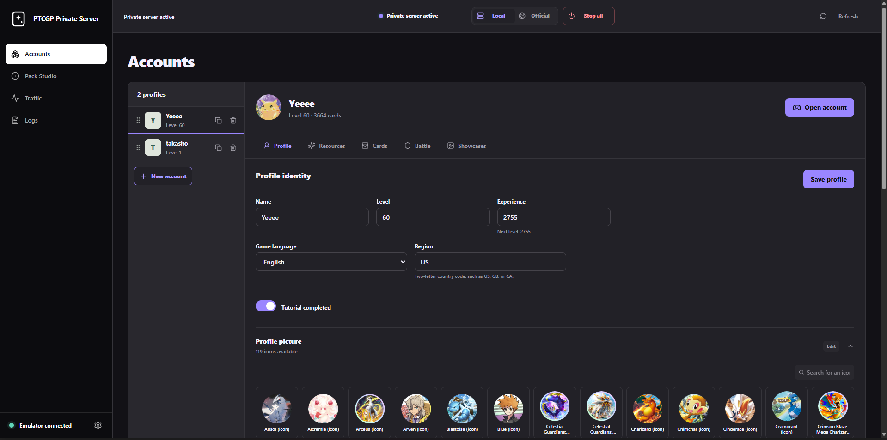
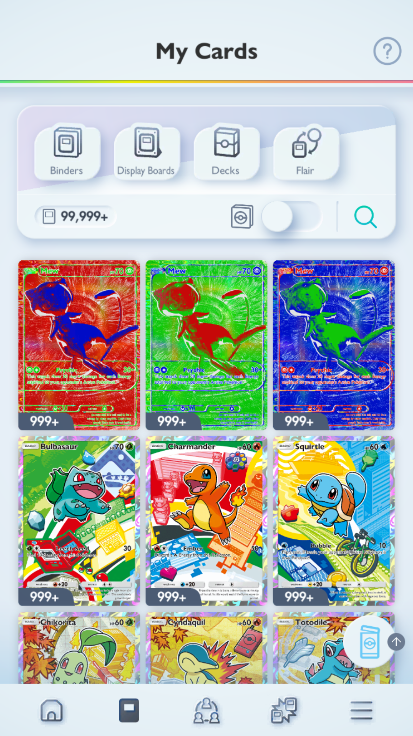

# PTCGP Private Server

Run Pokémon TCG Pocket against your own local server, create separate profiles,
edit their collections, and control pack openings from a browser.

> [!IMPORTANT]
> This is an unofficial, local-only interoperability project for advanced
> users. It currently supports Pokémon TCG Pocket **1.7.5** on Windows with a
> rooted Android emulator or rooted physical Android phone. It is not affiliated
> with Nintendo, The Pokémon Company, Creatures Inc., or DeNA.

[Download the latest release](https://github.com/Layen-lang/PTCGP-Private-Server/releases/latest)
· [Installation guide](docs/INSTALLATION.md)
· [User guide](docs/USAGE.md)
· [Troubleshooting](docs/TROUBLESHOOTING.md)

## See it in action

Manage independent local profiles, resources, collections, and cosmetics from
the control panel.

Open a local profile in the game and experiment with its collection without
touching an official account.

  

## What can you do with it?

- Create, duplicate, reorder, edit, and delete independent local profiles.
- Change a profile's level, experience, resources, cards, emblems, and
  cosmetics.
- Open a selected local profile directly in the game.
- Play on a rooted Android phone over USB or Wi-Fi ADB.
- Run different local profiles on several Android devices at the same time.
- Keep official pack odds or force a table, rarity, exact composition, or
  custom nonstandard pack.
- Inspect sanitized HTTP and gRPC traffic and follow launcher logs live.
- Switch safely between the private server and the official service.
- Receive updates automatically and install them from the control panel.

Local profiles are stored in SQLite on your computer. They do not replace or
modify your official account. PvP matchmaking and the bidirectional
`Battle/Connect` stream are not implemented.

## Before you start

You need:

- Windows 10 or later;
- Pokémon TCG Pocket **1.7.5**, installed by you;
- a rooted 64-bit Android phone (ARM64) or emulator (x86-64 or ARM64) that runs
  the supported ARM64 game, with ADB, root access, `adb reverse`, and writable
  system mounts;
- `adb.exe` available in `PATH`.

You do **not** need Go, Node.js, or Rust when using a published release. Those
tools are only required to run the project from source.

A rooted physical phone has been tested successfully, including over Wi-Fi ADB.
Root is required on phones too; developer options alone are insufficient.
See [phone setup over USB or Wi-Fi](docs/INSTALLATION.md#physical-android-phone-usb-or-wi-fi)
for the connection steps. The Windows computer still runs the server and must
stay on and connected while you play.

> [!CAUTION]
> Local mode temporarily changes Android routing, installs a local certificate
> authority, and applies a hash-verified patch to one game library. Always use
> **Official** before signing in to an official account. Never expose ports
> `443`, `8080`, `8081`, or additional emulators' game and administration ports
> to your network or the Internet.

The bundled configuration enables a separate home Wi-Fi panel listener on
port `8082`. See [Configuration](docs/CONFIGURATION.md#runtime) for access and
how to disable it.

## Install in 5 minutes

1. Download the ZIP from the
   [latest release](https://github.com/Layen-lang/PTCGP-Private-Server/releases/latest).
2. Extract the complete archive to a writable folder. Do not run it from inside
   the ZIP.
3. Start your rooted emulator, or connect your rooted phone using the
   [phone setup guide](docs/INSTALLATION.md#physical-android-phone-usb-or-wi-fi).
4. Open Command Prompt and check that `adb devices` lists the Android device as
   `device`.
5. Double-click `start-server.cmd`. The control panel opens at
   <http://127.0.0.1:8080>.
6. Let the panel import data from the installed game. Select a device if
   several are connected. The Accounts page opens when validation completes.

If any requirement is unclear, follow the
[step-by-step installation guide](docs/INSTALLATION.md) before continuing.

> [!TIP]
> **Automatic updates are built in — download once, then update from the panel.**
> Published releases automatically check for and download compatible, signed
> updates at startup and every six hours while the launcher is open. When an
> update is ready, click **Update and restart** at the bottom of the sidebar
> (**Mettre à jour et redémarrer** in French) to install it. Your local profiles
> and settings are preserved; no new ZIP needs to be downloaded manually.
> See [how updates work](docs/LOCAL-DATA-UPDATES.md#program-updates).

## First local profile

1. After preparation, select **Local** and wait for **Private server
   active**.
2. Open **Accounts**, select **New account**, and choose an empty or complete
   inventory.
3. Adjust the profile if needed, then select **Open account**.
4. When you finish, select **Official** to restore normal game routing, or
   **Stop all** to restore every managed emulator and close the local tools.

Choose the Android device at the top right, next to **Refresh**. To play on a
second device, select it, enable **Local**, and open a different profile. The
first game keeps running. Each profile can be used on only one device at a time.
**Local** and **Official** apply to the selected device; **Stop all** applies
to all managed devices. Switching devices or accounts reuses the prepared
game data.

The [user guide](docs/USAGE.md) explains every section of the control panel and
the safest daily workflow.

## Documentation

| Guide | For |
| --- | --- |
| [Documentation index](docs/README.md) | Finding the right guide |
| [Installation](docs/INSTALLATION.md) | Releases, source setup, and emulator checks |
| [Using the server](docs/USAGE.md) | Modes, profiles, packs, traffic, and backups |
| [Troubleshooting](docs/TROUBLESHOOTING.md) | Startup, ADB, root, ports, and recovery |
| [Configuration](docs/CONFIGURATION.md) | `server.json`, environment variables, and CLI |
| [Architecture](docs/ARCHITECTURE.md) | Components, ports, data flow, and boundaries |
| [Game data](docs/GAME-DATA.md) | Runtime data layout and compatibility |
| [Preparation and updates](docs/LOCAL-DATA-UPDATES.md) | First launch, recovery, and signed updates |
| [Development](docs/DEVELOPMENT.md) | Build, test, and release workflow |

Also see [Security](SECURITY.md), [Contributing](CONTRIBUTING.md), the
[changelog](CHANGELOG.md), and the [third-party notice](NOTICE.md).

## Data and privacy

The project stays on your machine by default:

| Path | Contents |
| --- | --- |
| `data/` | Profiles, SQLite database, logs, and runtime state |
| `certs/` | Locally generated certificate authority and private key |
| `profiles/` | Validated extraction and compatibility metadata |
| `data/generations/` | Locally imported game images and master data |

`data/` and `certs/` are ignored by Git. Treat them as private and never attach
them to a public issue without carefully reviewing their contents.

## License and third-party material

Original project code is available under the [MIT License](LICENSE). Pokémon
names, artwork, and game data remain the property of their respective owners
and are not covered by that license. See [NOTICE.md](NOTICE.md) for details.
